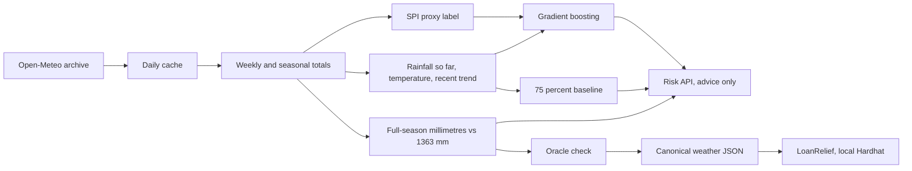

# RainCheck

Weather-adaptive loans for smallholder rice farmers. The rainfall record, the drought-stress proxy, and the risk API are in place, and a local contract can record a loan and one relief event per season. There is no dashboard yet.

A farmer's payment changes only when observed seasonal rainfall is below a number agreed up front. The model estimates how likely that kind of season is. It cannot change what is owed.

## Phase 1 layout

```
raincheck/
  README.md
  .env.example
  backend/
    region.json          # place, crop, season months, label rule, trigger rule
    app/                 # FastAPI: risk routes and loan routes
    ml/                  # labels, features, baseline, training
    data/                # Open-Meteo cache and the relief rule
    data/evidence/       # canonical JSON behind each relief transaction
    chain/               # web3 client, repayment schedule, evidence hash
    models/              # fitted model, metrics, held-out weekly scores
    tests/
  contracts/             # LoanRelief.sol, Hardhat tests, deploy
  scripts/               # one command: local node, deploy, API
  frontend/              # not built yet
```

Default place: Nueva Ecija, Philippines, 15.58 N, 121.00 E, rice, June–October. Edit `backend/region.json` to move it. The season months have to sit inside one calendar year.



## What the drought label is

There is no yield dataset. A complete June–October season is marked drought/stress when its seasonal SPI is at or below -1.0, the WMO "moderate drought or worse" cut.

SPI here is a simplified index, not an agency product:

1. Sum daily rainfall over the season.
2. Fit a two-parameter gamma distribution by method of moments (location fixed at 0) to the historical totals at this grid point. Sample variance uses `n - 1`.
3. SPI is the normal quantile of that gamma's cumulative probability. Probabilities are clipped to the range 0.000001–0.999999 so one extreme year cannot produce an infinite value.
4. A season missing more than 10% of its days is left out of the fit. Its label is empty, not "no drought".

On the cached record (Open-Meteo archive, 1 Jan 2001 through 18 Nov 2026, 9,453 local days) there are 26 complete seasons. The long-term average is 1,703.7 mm. Six seasons fall at or below SPI -1.0: 2001, 2003, 2004, 2007, 2008, and 2017.

## What fires relief

The trigger is separate from the label and from the model.

- Window: the full planting season, every day from 1 June through 31 October.
- Strike: 80% of the long-term average, unless `region.json` sets `trigger.rainfall_mm`.
- At this grid point that is **1,363 mm** (1,703.665 × 0.80, rounded half-up to a whole millimetre).
- It fires only when the observed total, also rounded half-up, is strictly below 1,363. Equality does not fire.
- It is evaluated when the season window has closed. Rain halfway through the season is not compared with the full-season line.
- Halves round away from zero (`10.5` mm becomes `11`). The later contract will use these integers because Solidity has no floats.

Seasons below the line in this cache: **2003** (1,235 mm), **2004** (1,244 mm), **2017** (1,239 mm).

2001, 2007, and 2008 are SPI droughts and still sit above 1,363 mm (about 85% of average). A proxy-drought label and a payment change are different events.

The Python rule also caps relief, so the contract can follow the same checks:

- a payment reduction, and the running total of reductions, must stay within `max_reduction_pct`
- a deferral, and the running total of deferred months, must stay within `max_deferral_months`
- the same relief type, value, and observed millimetres cannot be applied twice

The running cap on reductions is a choice to confirm before Phase 2. The brief caps each reduction and caps deferral both per call and in total. The running reduction cap stops a 30% term from being applied over and over.

## The model

Inputs at each full week of the season (21 weeks; the last 6 days of October are in the rainfall total and are not a model row):

- share of the season elapsed
- cumulative rainfall, and that total as a fraction of the normal for this week
- this week's rainfall, that week versus a normal week, and the change from the previous week
- average temperature so far, hottest day so far, and days at or above 35°C

The normal for a year leaves that year out. A season held out of training is compared only with the other seasons.

The model is a scikit-learn gradient boosting classifier: 100 trees, depth 2, learning rate 0.05, minimum 8 samples per leaf, subsample 0.9, `random_state` 42, balanced sample weights. Those settings were chosen for a small sample and were not searched after the scores came back.

The baseline is a fixed rule, not fit to the labels. It calls drought when rainfall so far is under 75% of the week-matched normal. Its probability is a straight line: 0.15 at 100% of normal, 0.50 at 75%, clipped to 0.02–0.98.

### Held-out scores

Leave-one-season-out. Each number below is one season, scored once, by a model that did not train on it. The independent sample is 26 seasons, of which 6 are proxy droughts. One season moving in or out will move these figures. Weeks inside one season share a single label, so they are not extra samples.

| Checkpoint | Model accuracy | Model drought recall | Model ROC-AUC | Baseline accuracy | Baseline drought recall | Baseline ROC-AUC |
| --- | --- | --- | --- | --- | --- | --- |
| Week 8 | 0.885 (23/26) | 0.667 (4/6) | 0.917 | 0.808 (21/26) | 0.500 (3/6) | 0.867 |
| Week 12 (headline) | 0.885 (23/26) | 0.833 (5/6) | 0.900 | 0.846 (22/26) | 0.333 (2/6) | 0.875 |
| Week 21 | 0.846 (22/26) | 0.667 (4/6) | 0.925 | 0.885 (23/26) | 0.500 (3/6) | 1.000 |

Week 12 is the early-warning number. Week 21 uses almost the whole season's rain, which is also what the label is built from. At that point the baseline ranks every season correctly (ROC-AUC 1) and is more accurate than the model.

At week 12 the model missed **2017**, one of the three driest seasons (rainfall already about 70% of normal by week 12; held-out probability about 0.06 all season). It raised false alarms for **2005** and **2009**. The 75% rule catches 2017 and misses the milder seasons. Full rows are in `backend/models/metrics.json`.

Historical replays use those held-out probabilities (`backend/models/loo_scores.json`). The file `risk_model.joblib` is refit on every season after the scores are computed, and is used only for a season that was not in the history. Showing the refit model's score on 2017 would hide the miss: that score is about 0.93, because 2017 was in its training set.

Local reasons are one-at-a-time swaps against the training median. They are not SHAP values, and they do not add up to the probability.

Plain-language text is a template. No language-model API is called.

## Run it

From `raincheck/backend`, with Python 3.11. The weather cache is already in the repo, so `ml.train` can be skipped when you only want to read it.

Windows PowerShell:

```powershell
py -3.11 -m venv .venv
.\.venv\Scripts\python -m pip install -r requirements.txt
.\.venv\Scripts\python -m ml.train
.\.venv\Scripts\python -m pytest
.\.venv\Scripts\python -m uvicorn app.main:app --port 8000
```

macOS or Linux:

```bash
python3.11 -m venv .venv
.venv/bin/python -m pip install -r requirements.txt
.venv/bin/python -m ml.train
.venv/bin/python -m pytest
.venv/bin/python -m uvicorn app.main:app --port 8000
```

`ml.train` downloads the Open-Meteo archive on the first run and writes `data/cache/`. Later runs use the cache, including offline. Set `FORCE_REFRESH_WEATHER=1` to download again. No API key is required. The risk routes do not read a chain key. `.env.example` has the local Hardhat URL and the public Hardhat oracle key, used only by the loan routes.

Then open `http://127.0.0.1:8000/docs`.

| Endpoint | Role |
| --- | --- |
| `GET /api/region` | Place, crop, season, proposed 1,363 mm strike, each season's rainfall, SPI, and proxy label |
| `GET /api/weather/observed?from=2015-06-01&to=2015-10-31&resolution=weekly` | Cached observations. `resolution` is `daily`, `weekly`, or `monthly` |
| `GET /api/risk` | Latest season: held-out score when one exists, band, reasons, template explanation, whether the 1,363 mm line was crossed |
| `POST /api/simulate` with `{"year": 2004}` | That season, week by week |
| `POST /api/loans` | Create a loan on the local contract. Trigger defaults to the 1,363 mm line |
| `GET /api/loans/{id}` | On-chain terms, relief history, schedule before and after |
| `POST /api/oracle/check/{id}?season=2017` | If the season total is strictly below the loan's trigger, record relief. Otherwise no transaction |
| `GET /api/evidence/{hash}` | Stored weather payload plus a recomputed keccak256 |
| `POST /api/demo/run` with `{"year": 2004}` | New loan, weekly replay, scores, and the schedule change in one response |

2004 is a useful replay: the held-out score is in the high band from early in the season, and the season total of 1,244 mm fires the trigger on the last step. 2017 fires the trigger as well, and the held-out model score stays near 0.06. That gap is real.

As of this cache, the 2026 wet season has ended: 1,731 mm, SPI 0.16, proxy label no, trigger not fired, held-out score about 0.015 (low).

## Run the demo

The demo needs a local chain. Install Node dependencies once, from `raincheck/contracts`:

```powershell
npm install
```

Then, from `raincheck`:

Windows PowerShell:

```powershell
.\scripts\dev.ps1
```

macOS or Linux:

```bash
./scripts/dev.sh
```

The script starts Hardhat, deploys `LoanRelief`, and serves the API. Hardhat's accounts and keys are written to `contracts/node.log` and are not printed in the window. That log is gitignored. The oracle key in the script is Hardhat's published account #1. It only has coins on a fresh local node.

```
API docs  http://127.0.0.1:8000/docs
RPC       http://127.0.0.1:8545
```

```powershell
Invoke-RestMethod -Method Post -Uri http://127.0.0.1:8000/api/demo/run -ContentType "application/json" -Body '{"year":2004}'
```

```bash
curl -s -X POST http://127.0.0.1:8000/api/demo/run -H "content-type: application/json" -d '{"year":2004}'
```

`POST /api/demo/run` always creates a new loan, because each loan allows one relief event per season. The response shape is stable:

| Field | Meaning |
| --- | --- |
| `weekly` | The same week rows as `POST /api/simulate` |
| `model_score`, `rule_score`, `score_source`, `score_week` | Last week that was actually scored, not a carried-forward week |
| `trigger` | Phase 1 whole-millimetre rule. `uses_model_score` is false |
| `chain_trigger` | Tenths of a millimetre, the comparison the contract uses |
| `loan` | New loan id and the create transaction |
| `relief` | `applied`, `tx_hash`, `evidence_hash`, and a message. No hash is invented when relief is not applied |
| `schedule_before`, `schedule_after`, `summary` | Installments in demo cents, and the cash and interest difference |
| `comparison_note`, `limitations` | The model does not change what is owed. The oracle problem and basis risk stay on the response |

2004 and 2017 both end under 1,363 mm, so both apply a 30% reduction for the next 3 installments. In 2017 the held-out model score stays near 0.06. The rainfall line still fires. 2026 is above the line, so the response says no relief and sends no transaction.

## Chain

`contracts/contracts/LoanRelief.sol` stores integers only.

| Quantity | Unit |
| --- | --- |
| Rainfall | Tenths of a millimetre. 1,363.0 mm is 13,630 |
| Rates and reductions | Basis points. 100% is 10,000. 30% is 3,000 |
| Money | Cents of a demo currency. 100 cents = 1.00. This is not legal tender and the contract does not move it |

The deployer is the owner. One oracle address is set in the constructor (Hardhat account #1) and only the owner can change it. Only the oracle can call `applyRelief`. The borrower or the oracle can call `recordPayment`. Loan terms have no setter.

`applyRelief` reverts unless every one of these holds:

1. The caller is the oracle.
2. The loan exists.
3. Observed rainfall is strictly below the loan's trigger. Equal does not fire.
4. A reduction is at most `maxReductionBps`, and the running total of reductions for that loan is also at most `maxReductionBps`.
5. A deferral, added to deferrals already stored, is at most `maxDeferralMonths`. A single deferral also cannot exceed that cap.
6. This `seasonId` has not been used on this loan, and this `dataSourceHash` has not been used on this loan.

The running cap on reductions is an explicit RainCheck decision. The brief caps each reduction and caps deferral both per call and in total. Capping the running reduction the same way stops a 30% term from being posted again in a later season. The contract does not read weather, a model score, or a schedule. It enforces the caps and records the event.

Phase 1 still compares whole millimetres (`data/trigger.py`, half-up). The contract compares tenths. A total of 1,362.6 mm is 1,363 whole millimetres (no relief in Phase 1) and 13,626 tenths (relief on chain if the trigger is 13,630). The demo seasons are not near that boundary, so both rules agree. The loan stores the tenths it was created with, so a later change to the average does not rewrite an old loan.

The oracle check builds one canonical JSON file: region, coordinates, season, the season rainfall total, the daily precipitation series, the Open-Meteo source, the cache fetch time, the trigger, the loan id, and the relief choice including the 3-month window. Keys are sorted and there is no space after `:` or `,`. keccak256 of those bytes is `dataSourceHash`. The file is `backend/data/evidence/<hash>.json`. `GET /api/evidence/{hash}` returns the file and hashes it again. The hash is not inside the file.

If the node is stopped, loan routes return HTTP 503 and do not invent a transaction. A second relief for the same loan and season returns HTTP 409.

## Repayment schedule

`backend/chain/schedule.py` is off-chain. The contract does not store it. Money is demo cents. Interest for a month is `balance * annual_rate_bps / (12 * 10000)`, half-up. The baseline payment is the standard annuity, half-up to cents. A zero rate splits the principal into equal cents and puts the remainder on the last installment. The last paying installment clears the balance.

Relief is applied as if it starts before installment 1, because the contract does not record which month an event belongs to.

- **Reduction.** The next N installments (default 3, and that N is inside the evidence hash) charge `round(payment * (10000 - bps) / 10000)`. The unpaid part stays in the balance. Later months are amortized again. If the window covers the whole term, the earlier months stay reduced and the last installment clears the balance.
- **Deferral.** The next M installments are 0. Interest is added to the balance and the term grows by M. The original number of paying months is then amortized on the new balance.
- Several events of one type are added together and applied once. If both types are present, the skip happens first.

`amount_saved_this_period_cents` is the cash difference on the skipped and reduced installments only. `total_interest_difference_cents` is interest after minus interest before. It is usually positive: the principal is not forgiven, and a smaller payment now means more interest later. The first payment date in the demo is 1 November of the replayed year.

The demo loan is 50,000.00 demo currency (5,000,000 cents), 12% a year, 12 months, trigger 13,630 tenths, max reduction 3,000 bps, max deferral 2 months. When the line fires, the oracle posts a 3,000 bps reduction. The borrower address is Hardhat account #2. No private key for that account is in the backend.

## Limits, stated here on purpose

- The archive value is weather at a grid point from Open-Meteo (CC-BY 4.0; attribute Open-Meteo). It is not a reading from one farm. That difference is basis risk.
- The local contract can prove what was written down. It cannot prove the weather feed was true. The backend key is the oracle, so this demo does not solve the oracle problem. Open-Meteo is the source (CC-BY 4.0; attribute Open-Meteo).
- The SPI flag is a rainfall proxy. It is not a measured crop loss, and it is not the official index from a meteorological service.
- This is a prototype. It is not a regulated loan, and it does not move money.
- Twenty-six seasons and six proxy droughts are a small sample. The week-12 scores will move if the record grows. The model can miss a severe dry season, as it did for 2017 when that year was held out.

## Tests

`pytest` from `backend/` covers weekly and monthly sums, season buckets, the SPI formula and the -1.0 cut, incomplete seasons, the 75% baseline, leave-one-year-out normals, the trigger (including the half-millimetre boundary), the relief caps, the Phase 1 API, the repayment schedule, the evidence hash, and the loan routes with a fake chain. The original 26 tests are still in that run. One integration test talks to a local Hardhat node and is skipped when port 8545 is closed.

From `contracts/`:

```powershell
npx hardhat test
```
