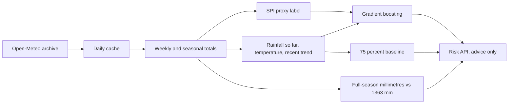

# RainCheck

Weather-adaptive loans for smallholder rice farmers. Phase 1 is the rainfall record, the drought-stress proxy, and the risk API. The loan contract and the dashboard are later phases.

A farmer's payment changes only when observed seasonal rainfall is below a number agreed up front. The model estimates how likely that kind of season is. It cannot change what is owed.

## Phase 1 layout

```
raincheck/
  README.md
  .env.example
  backend/
    region.json          # place, crop, season months, label rule, trigger rule
    app/                 # FastAPI
    ml/                  # labels, features, baseline, training
    data/                # Open-Meteo cache and the relief rule
    models/              # fitted model, metrics, held-out weekly scores
    tests/
  contracts/             # Phase 2, not built yet
  frontend/              # Phase 4, not built yet
```

Default place: Nueva Ecija, Philippines, 15.58 N, 121.00 E, rice, June–October. Edit `backend/region.json` to move it. The season months have to sit inside one calendar year.



## What the drought label is

There is no yield dataset. A complete June–October season is marked drought/stress when its seasonal SPI is at or below -1.0, the WMO "moderate drought or worse" cut.

SPI here is a simplified index, not an agency product:

1. Sum daily rainfall over the season.
2. Fit a two-parameter gamma distribution by method of moments (location fixed at 0) to the historical totals at this grid point. Sample variance uses `n - 1`.
3. SPI is the normal quantile of that gamma's cumulative probability. Probabilities are clipped to the range 0.000001–0.999999 so one extreme year cannot produce an infinite value.
4. A season missing more than 10% of its days is left out of the fit. Its label is empty, not "no drought".

On the cached record (Open-Meteo archive, 1 Jan 2001 through 18 Nov 2026, 9,453 local days) there are 26 complete seasons. The long-term average is 1,703.7 mm. Six seasons fall at or below SPI -1.0: 2001, 2003, 2004, 2007, 2008, and 2017.

## What fires relief

The trigger is separate from the label and from the model.

- Window: the full planting season, every day from 1 June through 31 October.
- Strike: 80% of the long-term average, unless `region.json` sets `trigger.rainfall_mm`.
- At this grid point that is **1,363 mm** (1,703.665 × 0.80, rounded half-up to a whole millimetre).
- It fires only when the observed total, also rounded half-up, is strictly below 1,363. Equality does not fire.
- It is evaluated when the season window has closed. Rain halfway through the season is not compared with the full-season line.
- Halves round away from zero (`10.5` mm becomes `11`). The later contract will use these integers because Solidity has no floats.

Seasons below the line in this cache: **2003** (1,235 mm), **2004** (1,244 mm), **2017** (1,239 mm).

2001, 2007, and 2008 are SPI droughts and still sit above 1,363 mm (about 85% of average). A proxy-drought label and a payment change are different events.

The Python rule also caps relief, so the contract can follow the same checks:

- a payment reduction, and the running total of reductions, must stay within `max_reduction_pct`
- a deferral, and the running total of deferred months, must stay within `max_deferral_months`
- the same relief type, value, and observed millimetres cannot be applied twice

The running cap on reductions is a choice to confirm before Phase 2. The brief caps each reduction and caps deferral both per call and in total. The running reduction cap stops a 30% term from being applied over and over.

## The model

Inputs at each full week of the season (21 weeks; the last 6 days of October are in the rainfall total and are not a model row):

- share of the season elapsed
- cumulative rainfall, and that total as a fraction of the normal for this week
- this week's rainfall, that week versus a normal week, and the change from the previous week
- average temperature so far, hottest day so far, and days at or above 35°C

The normal for a year leaves that year out. A season held out of training is compared only with the other seasons.

The model is a scikit-learn gradient boosting classifier: 100 trees, depth 2, learning rate 0.05, minimum 8 samples per leaf, subsample 0.9, `random_state` 42, balanced sample weights. Those settings were chosen for a small sample and were not searched after the scores came back.

The baseline is a fixed rule, not fit to the labels. It calls drought when rainfall so far is under 75% of the week-matched normal. Its probability is a straight line: 0.15 at 100% of normal, 0.50 at 75%, clipped to 0.02–0.98.

### Held-out scores

Leave-one-season-out. Each number below is one season, scored once, by a model that did not train on it. The independent sample is 26 seasons, of which 6 are proxy droughts. One season moving in or out will move these figures. Weeks inside one season share a single label, so they are not extra samples.

| Checkpoint | Model accuracy | Model drought recall | Model ROC-AUC | Baseline accuracy | Baseline drought recall | Baseline ROC-AUC |
| --- | --- | --- | --- | --- | --- | --- |
| Week 8 | 0.885 (23/26) | 0.667 (4/6) | 0.917 | 0.808 (21/26) | 0.500 (3/6) | 0.867 |
| Week 12 (headline) | 0.885 (23/26) | 0.833 (5/6) | 0.900 | 0.846 (22/26) | 0.333 (2/6) | 0.875 |
| Week 21 | 0.846 (22/26) | 0.667 (4/6) | 0.925 | 0.885 (23/26) | 0.500 (3/6) | 1.000 |

Week 12 is the early-warning number. Week 21 uses almost the whole season's rain, which is also what the label is built from. At that point the baseline ranks every season correctly (ROC-AUC 1) and is more accurate than the model.

At week 12 the model missed **2017**, one of the three driest seasons (rainfall already about 70% of normal by week 12; held-out probability about 0.06 all season). It raised false alarms for **2005** and **2009**. The 75% rule catches 2017 and misses the milder seasons. Full rows are in `backend/models/metrics.json`.

Historical replays use those held-out probabilities (`backend/models/loo_scores.json`). The file `risk_model.joblib` is refit on every season after the scores are computed, and is used only for a season that was not in the history. Showing the refit model's score on 2017 would hide the miss: that score is about 0.93, because 2017 was in its training set.

Local reasons are one-at-a-time swaps against the training median. They are not SHAP values, and they do not add up to the probability.

Plain-language text is a template. No language-model API is called.

## Run it

From `raincheck/backend`, with Python 3.11:

```powershell
py -3.11 -m venv .venv
.\.venv\Scripts\python -m pip install -r requirements.txt
.\.venv\Scripts\python -m ml.train
.\.venv\Scripts\python -m pytest
.\.venv\Scripts\python -m uvicorn app.main:app --port 8000
```

`ml.train` downloads the Open-Meteo archive on the first run and writes `data/cache/`. Later runs use the cache, including offline. Set `FORCE_REFRESH_WEATHER=1` to download again. No API key is required. `.env.example` lists the variables later phases may use. None of them are read in Phase 1.

Then open `http://127.0.0.1:8000/docs`.

| Endpoint | Role |
| --- | --- |
| `GET /api/region` | Place, crop, season, proposed 1,363 mm strike, each season's rainfall, SPI, and proxy label |
| `GET /api/weather/observed?from=2015-06-01&to=2015-10-31&resolution=weekly` | Cached observations. `resolution` is `daily`, `weekly`, or `monthly` |
| `GET /api/risk` | Latest season: held-out score when one exists, band, reasons, template explanation, whether the 1,363 mm line was crossed |
| `POST /api/simulate` with `{"year": 2004}` | That season, week by week |

2004 is a useful replay: the held-out score is in the high band from early in the season, and the season total of 1,244 mm fires the trigger on the last step. 2017 fires the trigger as well, and the held-out model score stays near 0.06. That gap is real.

As of this cache, the 2026 wet season has ended: 1,731 mm, SPI 0.16, proxy label no, trigger not fired, held-out score about 0.015 (low).

## Limits, stated here on purpose

- The archive value is weather at a grid point from Open-Meteo (CC-BY 4.0; attribute Open-Meteo). It is not a reading from one farm. That difference is basis risk.
- A later blockchain record can prove what was written down. It cannot prove the weather feed was true. That is the oracle problem. Phase 1 does not write a contract yet.
- The SPI flag is a rainfall proxy. It is not a measured crop loss, and it is not the official index from a meteorological service.
- This is a prototype. It is not a regulated loan, and it does not move money.
- Twenty-six seasons and six proxy droughts are a small sample. The week-12 scores will move if the record grows. The model can miss a severe dry season, as it did for 2017 when that year was held out.

## Tests

`pytest` covers weekly and monthly sums, season buckets, the SPI formula and the -1.0 cut, incomplete seasons, the 75% baseline, leave-one-year-out normals, the trigger (including the half-millimetre boundary), the relief caps, and the API against the cache. The last run was 26 passed. The two API tests skip until `python -m ml.train` has written the cache and the model.
